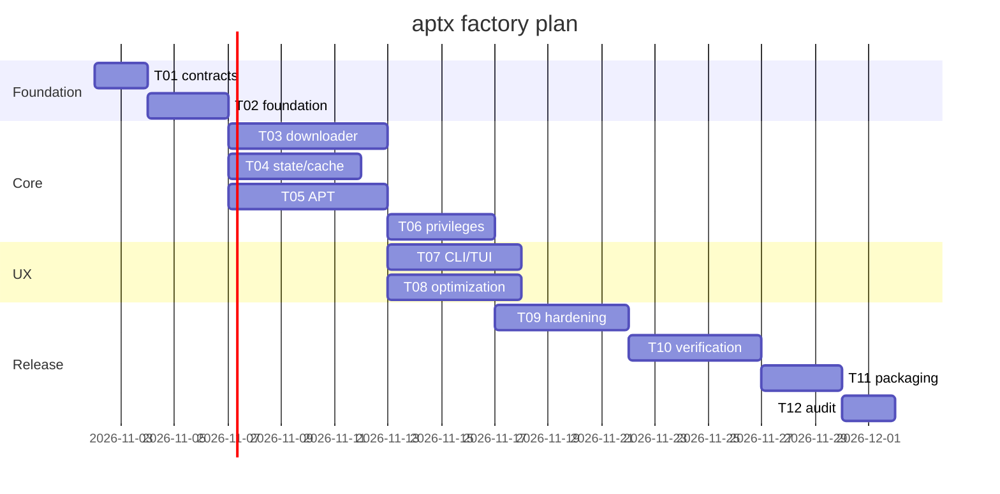

# Gantt (estimated working days)

Dates indicative; update from verified progress.

## Actual checkpoint — 2026-10-30

The estimates above are retained as the original plan. Local implementation and
candidate builds now exist; T09–T12 release evidence remains incomplete. No elapsed
workday estimates are presented as measured completion. See STATUS_REPORT.md.
